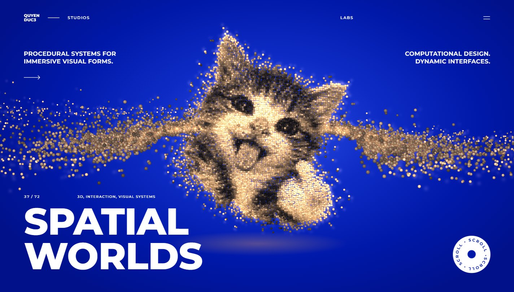

# QUYENDUC3: Spatial Worlds

[Live demo](https://ducquyen3.github.io/quyenduc3-spatial-worlds/)

A scroll-driven 3D hero section. About 7,000 glowing spheres gather into a cat when the page loads, and as you scroll the cat breaks apart and re-forms as a ringed planet.

Built with Three.js and plain HTML, CSS and JavaScript. There is no build step.

## What happens on the page

When the page opens, the spheres fly in from a scattered cloud and settle into the shape of the cat. Each sphere is a small bead of warm light with its own soft halo, and its brightness follows the original cat picture, so the light fur glows and the stripes and eyes stay dark.

The hero stays pinned while you scroll. The two corner lines fade out, and the cat turns into a planet with a glowing rim, a ring of spheres around it, and far-off spheres that twinkle like stars. The round SCROLL badge spins on its own, winds faster as you scroll, and takes you straight to the end (or back to the top) when clicked.

The menu opens as a circle growing out of the menu button. On phones the layout rearranges, and people who have reduced motion turned on get a still version without the scroll animation.

## How it is made

The spheres are drawn as points with a custom shader that shades each one like a small ball, so thousands of them cost little to draw. The halos are rendered at half resolution and added on top, which kept the page at 60 fps at normal resolution and 53 to 56 fps at double resolution on an Intel Iris Xe laptop chip. If a device still can't keep up, the page lowers its resolution a step at a time instead of stuttering.

The cat comes from an AI-generated image. `tools/bake-cat.html` removes the background, samples the picture into a grid and writes the result to `cat-data.js`: the position, depth and brightness of each sphere. To use a different picture, open the tool in a browser, load the image and download a new `cat-data.js`.

## Files

- `index.html`: page markup
- `styles.css`: layout, colours and type (Montserrat on cobalt blue `#0018A8`)
- `hero.js`: scroll progress, badge, entrance and menu
- `world.js`: the Three.js scene, shaders and the cat-to-planet morph
- `cat-data.js`: baked sphere data for the cat
- `tools/bake-cat.html`: turns an image into `cat-data.js`

## Running it

Visit the [live demo](https://ducquyen3.github.io/quyenduc3-spatial-worlds/), or open `index.html` in a browser. It also works straight from the file, without a local server. Three.js and the font load from CDNs, so you need an internet connection.
